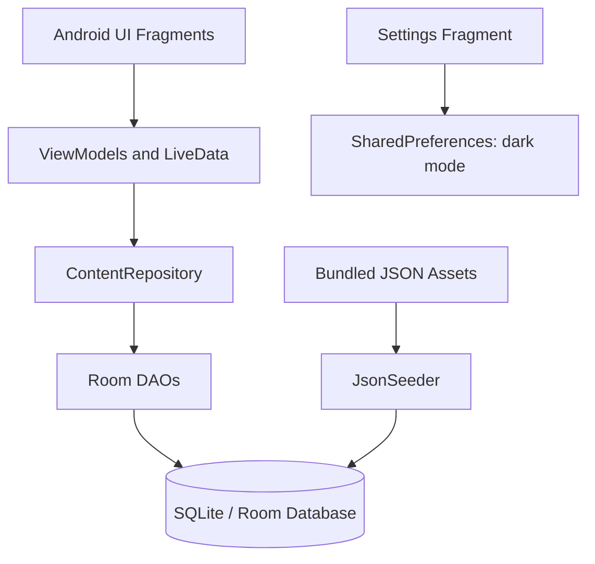
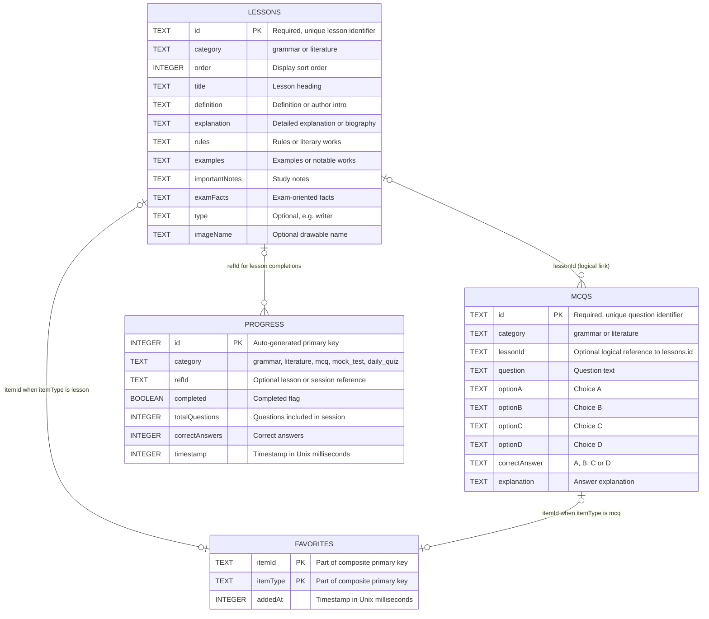

# BanglaGuru (বাংলাগুরু)

**An offline-first Bengali grammar, literature, and multiple-choice exam preparation app for Android.**

BanglaGuru helps Bengali-speaking learners revise essential grammar rules, explore Bengali literature and notable authors, practice chapter-based MCQs, take mock tests, and track their learning progress without requiring an internet connection or an account.

> **Source release:** `v2.0` | **Platform:** Native Android (Java) | **Application ID:** `com.banglaguru.app`  
> This repository documents the **native Java/Android v2.0 project**. It is not the separate Flutter v3 project.

## Contents

- [Project overview](#project-overview)
- [Features](#features)
- [Content inventory](#content-inventory)
- [Technology stack](#technology-stack)
- [Architecture](#architecture)
- [Entity-relationship diagram](#entity-relationship-diagram)
- [Database schema](#database-schema)
- [Project structure](#project-structure)
- [Getting started](#getting-started)
- [Offline content and seeding](#offline-content-and-seeding)
- [Build and release](#build-and-release)
- [Known limitations](#known-limitations)
- [Repository information](#repository-information)

## Project overview

BanglaGuru is designed for self-paced Bangla-language study and exam revision, including school/college examinations, admission preparation, and competitive examinations such as BCS, bank recruitment, and primary teacher recruitment. Study material and practice questions are shipped inside the Android app, then loaded into a local Room database on first launch.

**Goals**

- Make Bengali grammar and literature lessons available offline.
- Combine topic-focused reading with associated multiple-choice questions.
- Offer flexible practice sessions and mock examinations.
- Keep favorites and basic completion/score history on the device.
- Provide a simple Bengali interface with light and dark themes.

No online account, API key, server, or network permission is required by this version.

## Features

| Area | Implementation in v2.0 |
| --- | --- |
| Home | Welcome section, study shortcuts, and learning summary. |
| Bengali grammar | 25 lesson entries covering definitions, explanations, rules, examples, notes, and examination facts. |
| Bengali literature | 15 lesson entries, including 7 author-profile entries with biography-style sections. |
| Chapter MCQs | Questions linked to lessons through `mcqs.lessonId`; shown on the relevant lesson page. |
| MCQ practice | Grammar, literature, or mixed questions; Easy (up to 10), Medium (up to 25), Hard (up to 50), and Random (up to 20). |
| Mock test | Requests 50 randomly selected mixed questions from the available question bank. |
| Daily quiz | Requests 10 randomly selected questions per session; not locked to a specific calendar day. |
| Quiz results | Stores the total questions and correct answers for submitted sessions. |
| Favorites | Save/unsave lessons and browse favorite lessons. The database can also represent MCQ favorites, but the current Favorites screen lists lessons. |
| Progress | Stores lesson-completion events and quiz/test results; displays aggregated statistics. |
| Settings | Persists the dark-mode preference using `SharedPreferences`. |

The bottom navigation contains **Home, Grammar, Literature, MCQ, and More**. The **More** screen provides Mock Test, Daily Quiz, Favorites, Progress, and Settings.

## Content inventory

The packaged JSON assets were counted directly from this source snapshot:

| Asset | Contents | Entries |
| --- | --- | ---: |
| `grammar_lessons.json` | Grammar lessons | 25 |
| `literature_lessons.json` | Literature lessons | 15 |
| `mcq_grammar.json` | Grammar MCQs | 48 |
| `mcq_literature.json` | Literature MCQs | 32 |
| **Total** | **40 lessons + 80 MCQs** | **120** |

The MCQ set is an expandable starter bank, not a comprehensive examination question database. Practice modes request a fixed maximum, but fewer questions are shown when the selected category contains fewer records than requested.

## Technology stack

| Component | Version / approach |
| --- | --- |
| Language | Java, Java 11 source compatibility |
| UI | Android XML, Material Components, RecyclerView, View Binding |
| Architecture | MVVM with a repository layer |
| Local database | Room `2.6.1`, backed by SQLite |
| Reactive state | AndroidX `LiveData` and `ViewModel` (`2.8.0`) |
| Navigation | AndroidX Navigation Component (`2.7.7`) |
| JSON parsing | Gson `2.10.1` |
| Build tool | Android Gradle Plugin `8.4.0`, Gradle wrapper `8.6` |
| Compile SDK | Android API `35` |
| Target SDK | Android API `35` |
| Minimum SDK | Android API `24` (Android 7.0) |
| Package / application ID | `com.banglaguru.app` |
| App version in Gradle | `versionName "2.0"`, `versionCode 2` |
| Room database | `bangla_guru.db`, schema version `2` |

## Architecture

BanglaGuru uses a local, repository-mediated data flow. UI Fragments observe LiveData from ViewModels; ViewModels use a shared `ContentRepository`, which accesses Room DAOs. The application seeds packaged JSON assets into the database on first launch.



The application entry point is `BanglaGuruApp`, which applies the stored theme setting and schedules the initial JSON import on a background executor.

## Entity-relationship diagram

The local database declares **four Room entities**. The diagram below includes **every field found in the source model classes**.



**Relationship details:** These connectors describe *logical relationships used or supported by the application*, **not SQLite-enforced foreign keys**. The Java models do not declare Room `@ForeignKey` constraints. In particular:

1. `mcqs.lessonId` is a nullable string that can identify a row in `lessons.id`. One lesson can have many associated questions.
2. `favorites` has a **composite primary key** of (`itemId`, `itemType`). The `itemType` differentiates `lesson` references from `mcq` references; no separate `users` table exists.
3. `progress.refId` identifies a lesson when `category` is `grammar` or `literature`. For quiz/test progress records, it may be null. A lesson may have multiple progress rows because completion is recorded as events, rather than a unique per-lesson state.
4. No separate `quiz_sessions`, `answers`, `authors`, or `users` entity exists in this version. Quiz answers are held in ViewModel memory until the session is submitted; aggregate results are persisted to `progress`.

## Database schema

| Table | Primary key | Purpose | Access component |
| --- | --- | --- | --- |
| `lessons` | `id` (`TEXT`) | Grammar/literature lesson text and optional author metadata. | `LessonDao` |
| `mcqs` | `id` (`TEXT`) | MCQ question, four options, correct-answer key, explanation, lesson association. | `McqDao` |
| `favorites` | (`itemId`, `itemType`) composite key | Locally bookmarked items with addition timestamp. | `FavoriteDao` |
| `progress` | `id` (auto-generated integer) | Lesson completion events and quiz/mock/daily result summaries. | `ProgressDao` |

**Important implementation notes**

- Database name: `bangla_guru.db`; Room version: `2`.
- Lessons and MCQs are read from JSON and inserted only if their corresponding table is empty.
- `Progress.category` may be `grammar`, `literature`, `mcq`, `mock_test`, or `daily_quiz`.
- `Progress.totalQuestions` and `Progress.correctAnswers` are used for quiz/test summaries; lesson-completion rows usually leave those values at their default `0`.
- `Favorite.addedAt` and `Progress.timestamp` use Unix time in milliseconds.
- The current database configuration uses `fallbackToDestructiveMigration()`. A schema upgrade without a defined migration can clear local data; create explicit Room migrations for a production-grade upgrade path.

For a standalone Mermaid source copy, see [`docs/ER_DIAGRAM.mmd`](docs/ER_DIAGRAM.mmd).

## Project structure

```text
BanglaGuru/
├── app/
│   ├── build.gradle
│   ├── proguard-rules.pro
│   └── src/main/
│       ├── AndroidManifest.xml
│       ├── assets/
│       │   ├── grammar_lessons.json
│       │   ├── literature_lessons.json
│       │   ├── mcq_grammar.json
│       │   └── mcq_literature.json
│       ├── java/com/banglaguru/app/
│       │   ├── BanglaGuruApp.java
│       │   ├── data/
│       │   │   ├── JsonSeeder.java
│       │   │   ├── model/               # Room entities
│       │   │   ├── db/                  # AppDatabase and DAOs
│       │   │   └── repository/          # ContentRepository
│       │   ├── ui/                      # Activities, fragments, ViewModels
│       │   └── util/                    # AppExecutors
│       └── res/
│           ├── layout/                 # XML layouts
│           ├── navigation/             # Navigation graph
│           ├── menu/                   # Bottom navigation
│           └── values/                 # Strings, themes, colors
├── docs/
│   └── ER_DIAGRAM.mmd
├── gradle/wrapper/
├── gradlew
├── gradlew.bat
├── settings.gradle
├── build.gradle
├── gradle.properties
├── .gitignore
├── README.md
├── RELEASE_NOTES_v2.0.md
└── GITHUB_PUBLISH_GUIDE.md
```

The repository source archive intentionally excludes machine-specific files, signing credentials, Gradle caches, generated build outputs, and prebuilt Android bundles.

## Getting started

### Requirements

- Android Studio with an installed **Android SDK Platform 35**.
- **JDK 17** for Gradle/Android Gradle Plugin execution (Java 11 is the source-code compatibility target).
- Android emulator or physical Android device running **API 24+**.
- Internet access for the *initial Gradle dependency download*; the installed app itself works offline.

### Run in Android Studio

1. Clone or download the GitHub repository, then open its root `BanglaGuru` project directory in Android Studio.
2. Wait for Gradle sync and dependency resolution to complete.
3. Ensure SDK Platform 35 is installed under **SDK Manager**.
4. Select an emulator or connected Android device (Android 7.0+).
5. Click **Run** to install the debug build.

### Build from the command line

**macOS / Linux:**

```bash
./gradlew :app:assembleDebug
```

**Windows (PowerShell / Command Prompt):**

```powershell
.\gradlew.bat :app:assembleDebug
```

The debug APK is typically generated at `app/build/outputs/apk/debug/app-debug.apk`.

## Offline content and seeding

On first application launch, `BanglaGuruApp` schedules `JsonSeeder.seedIfEmpty()` on a background thread. It imports:

```text
assets/grammar_lessons.json    -> lessons
assets/literature_lessons.json -> lessons
assets/mcq_grammar.json        -> mcqs
assets/mcq_literature.json     -> mcqs
```

To extend the question bank, add valid JSON objects using the existing structure in the MCQ asset files. A new object should have a unique `id`, `category`, optional `lessonId`, `question`, `optionA` through `optionD`, `correctAnswer` (`A`/`B`/`C`/`D`), and `explanation`.

**Note:** Existing installations are not automatically updated when the bundled JSON changes, because `JsonSeeder` runs only when each target table is empty. During development, clear app data or reinstall to test updated seed content. For real users, implement content-version-aware synchronization or database migrations before shipping a content update.

## Build and release

### Current release information

| Field | Value |
| --- | --- |
| Release title | `BanglaGuru v2.0 - Offline Bengali Exam Preparation` |
| Git tag | `v2.0` |
| Application ID | `com.banglaguru.app` |
| Version name / code | `2.0` / `2` |
| Artifact type | Android App Bundle (`.aab`) for Google Play |
| Build source | Existing v2.0 release bundle from the supplied project archive |

An **existing** signed AAB was supplied with the source archive. That artifact should be uploaded as a **GitHub Release asset**, not committed to the Git repository. The AAB is not an ordinary directly installable APK.

### Create a new signed release in Android Studio

1. Open **Build > Generate Signed Bundle / APK**.
2. Choose **Android App Bundle** and proceed.
3. Select your private signing keystore and enter credentials *locally*.
4. Choose the `release` build variant and generate the signed `.aab`.
5. Check the Google Play Console's current target SDK, signing, version-code, and release requirements before submitting.

The Gradle source does not contain a release signing configuration. Do not expect a plain `bundleRelease` command alone to create a ready-to-publish signed AAB without signing setup.

**Never commit** `.jks`, `.keystore`, signing passwords, `local.properties`, or release credentials. Keep a secure offline backup of the original signing key for future updates. Version codes must increase for subsequent Google Play uploads; for example, a v3 release must use a code greater than `2`.

See [`RELEASE_NOTES_v2.0.md`](RELEASE_NOTES_v2.0.md) for a ready-to-paste GitHub Release description.

## Known limitations

This section describes the code as provided, not speculative future functionality.

- The packaged bank has 80 MCQs. For a category with fewer questions than the requested practice mode, the returned set is smaller (for example, the grammar bank has 48 questions).
- Daily Quiz creates a fresh random set when started; there is no once-per-calendar-day lock or persistent daily question schedule.
- Lesson completion creates a new `progress` record each time; the completed-lesson count can overcount repeated clicks.
- MCQ answer selection and per-question review are not stored as durable history. Only aggregate session scores are recorded.
- The Room database uses destructive fallback for schema version changes without migrations.
- The Settings screen's bundled localized version label is still `1.0` although `app/build.gradle` defines version `2.0`; update this string before the next app build.
- There is no authentication, backend, cross-device synchronization, or online content-update service in this source version.

## Repository information

**Suggested GitHub repository description:**

> BanglaGuru is an offline Bengali grammar and literature learning app for Android, featuring lessons, MCQ practice, mock tests, favorites, progress tracking, and a local Room database.

**Suggested GitHub topics:**

`android` `android-app` `java` `bengali` `bangla` `education` `exam-preparation` `bengali-grammar` `bengali-literature` `mcq` `android-jetpack` `room-database` `mvvm` `offline-first`

**Licensing:** No open-source license is included in this snapshot. If the owner intends to allow reuse or redistribution, add an appropriate license explicitly. Publishing a public repository does not automatically grant an open-source license.

---

Built for accessible, offline Bengali study and examination preparation.
